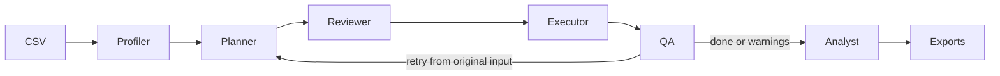

# AutoWrangler

AutoWrangler prepares CSV datasets through a constrained multi-step workflow. An optional language model proposes a typed cleaning plan; a deterministic Pandas executor applies the allowlisted operations. The same LangGraph workflow powers the Streamlit app and command-line interface. If no model is configured or available, a conservative local planner and factual local report keep the workflow usable offline.

## Architecture



See [the architecture guide](docs/CAPSTONE_ARCHITECTURAL_SPEC.md) for data flow, model boundaries, operation behavior and limitations.

## Features

- Schema-constrained plans validated with Pydantic; no LLM-generated code is executed.
- LangGraph QA retry loop with the configured retry count. Retries start from the original CSV.
- Local fallback planning and reporting when a provider is not configured or reachable.
- Consistent handling of missing values and common placeholders such as `NULL`, `N/A`, `ERROR` and `-`.
- Identifier-like columns are preserved as text, including leading zeroes; unsafe numeric operations on those fields are skipped.
- Groq, Mistral and Ollama integrations.
- Interactive data profiles, anomaly views, missing-value maps and before/after comparison.
- CSV, JSON, SQLite, Markdown, standalone Python and Jupyter Notebook exports.
- Reproducibility passport with input/output/plan SHA-256 digests and runtime metrics.
- Offline synthetic benchmark for anomaly precision, recall, F1 and missing-value reduction.

## Quick start

Use Python 3.12 or 3.13.

```powershell
python -m venv .venv
.\.venv\Scripts\Activate.ps1
python -m pip install -r requirements-dev.txt
streamlit run streamlit_app.py
```

The dashboard starts with a demo dataset and also includes zoning, sensor telemetry and CSV upload presets.

### Language models

Copy `.env.example` to `.env`, then set one or more keys there (the local `.env` is ignored by Git):

```dotenv
GROQ_API_KEY=your_key
# MISTRAL_API_KEY=your_key
# AUTOWRANGLER_LLM_PROVIDER=groq
```

Choose a provider in the dashboard. For Ollama, install and start Ollama separately, pull a model, then set:

```dotenv
AUTOWRANGLER_LLM_PROVIDER=ollama
OLLAMA_MODEL=llama3.1
```

If no model is available, planning/reporting fall back to local deterministic behavior. The planner receives schema and aggregate profile metadata, not raw rows.

## Command line

```powershell
# Use the bundled demo and print a summary
python app.py

# Clean a CSV and save the cleaned output
python app.py path\to\dataset.csv --output cleaned.csv

# Select a provider, anomaly threshold and QA retry limit
python app.py path\to\dataset.csv --provider ollama --zscore-threshold 2.8 --max-retries 2
```

Arguments:

- `--output`: optional persistent path for the cleaned CSV.
- `--provider`: `groq`, `mistral` or `ollama`.
- `--zscore-threshold` (or `--zscore`): number greater than 0 and at most 10; default 3.0.
- `--max-retries`: 0–5; default 1.

## Reports and evaluation

Generate a Markdown run passport:

```powershell
python reports/generate_passport.py data/messy_data.csv --output reports/reproducibility_passport.md
```

Run the deterministic, offline benchmark:

```powershell
python reports/evaluation_benchmark.py
```

The benchmark uses fixed seeds and labeled synthetic outliers; its measurements describe that synthetic case and do not predict performance on arbitrary datasets.

## Tests

```powershell
python -m pytest tests/ -v
```

The test suite mocks model calls and does not need API keys or a running Ollama service.

## Docker

```powershell
docker build -t autowrangler .
docker run --rm -p 8501:8501 --env-file .env autowrangler
```

The image runs Streamlit as an unprivileged user. The health check uses Python's standard library, so it does not depend on `curl`.

## Dataset and privacy notes

Uploaded data is written to a uniquely named OS temporary file for the current Streamlit session and cleaned up when replaced or when the server process exits. The pipeline keeps a working CSV temporarily so the dashboard can preview and export the result. No raw rows are sent to the model. User-supplied domain context and chat questions may be sent to the selected provider; chat uses aggregate metrics only.

Review transformations, unresolved missing values, and anomaly flags before using output in production. Date parsing can be ambiguous across locales, and Z-score flags are review signals rather than proof of errors.
