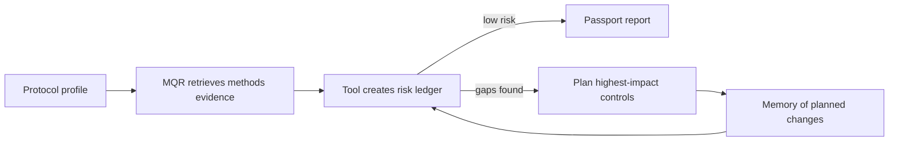

# ReproTrace: Reproducibility Audit Orchestrator

ReproTrace is an evidence-grounded protocol-quality system for research projects. It does not merely summarize a checklist. It retrieves methodological evidence, calls a deterministic risk-scoring tool, uses a bounded LangGraph loop to compare mitigations, stores audit history, and produces a reproducibility passport.

## Why this is a strong capstone

Most RAG projects answer questions from documents. ReproTrace makes a transparent decision process:



The outcome is an **auditable before/after protocol plan**, not a generic answer. Verified safeguards and planned safeguards are deliberately separate.

## Required architecture

| Constraint | How ReproTrace uses it |
| --- | --- |
| LangChain | Documents, retriever interface, `@tool`, `MultiQueryRetriever` |
| RAG / MQR | Three query lenses: preregistration, power/sample design, governance/transparency |
| Tool calling | `calculate_reproducibility_risk` builds a numeric control ledger; `save_reproducibility_passport` writes the report |
| Memory | `MemorySaver` checkpoints runs; `InMemoryStore` retains protocol profile and mitigation plans |
| LangGraph | Explicit ingest → retrieve → audit → plan controls → re-audit → finalize workflow |

## Run it

```bash
pip install -r requirements.txt
python main.py --scenario "under-specified study"
streamlit run streamlit_app.py
python -m unittest discover -v
```

The local fallback makes MQR retrieval runnable with no API keys.

## Project files

```text
main.py                            LangGraph workflow, MQR, tools, memory, CLI
streamlit_app.py                   Interactive audit workspace
data/reproducibility_corpus.json   Local methodological evidence
docs/CAPSTONE_GUIDE.md             Presentation narrative and demo script
docs/EVALUATION_PLAN.md            Acceptance criteria and evaluation strategy
```

## Important boundary

The local corpus is illustrative. ReproTrace is not ethics approval, peer review, clinical guidance, or a guarantee of reproducibility. A planned control is a recommendation, never proof that a safeguard has been completed.
