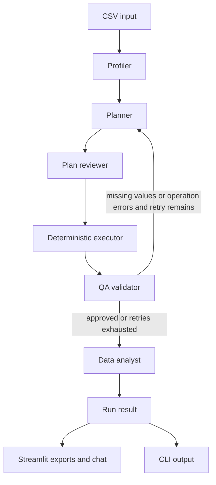

# AutoWrangler architecture and behavior

This document describes the source in this repository. It is not a claim that a packaged or deployed build was inspected.

## Purpose

AutoWrangler turns an input CSV into a cleaned CSV plus a run report. A language model can propose and review a cleaning plan, but it never writes or executes code. The executor accepts a fixed list of operations and applies them with Pandas. If a model is unavailable, the planner and analyst switch to local deterministic behavior.

## Runtime flow

### Data flow and state

| Stage | Reads | Writes or decides | External service |
|---|---|---|---|
| Profiler | Input CSV | Schema, counts, dtype and parse-rate profile, source digest, a working CSV in the OS temp directory | None |
| Planner | Schema, profile, user domain brief, prior QA feedback | A Pydantic `CleaningPlan` | Selected LLM, if configured; local heuristic plan otherwise |
| Plan reviewer | Schema and proposed plan | Revised plan where the model can validate it | Selected LLM; review failure is logged and execution remains bounded by validation |
| Executor | Original CSV on a retry; working CSV on the first pass | Transformed working CSV, final metrics, plan digest | None |
| QA validator | Working CSV and execution errors | Retry decision or a completed status with any remaining nulls reported | None |
| Analyst | Aggregate metrics and anomaly counts | Narrative and recommendations | Selected LLM; factual local report otherwise |
| Streamlit | Run state and cleaned CSV | Tables, visualizations, downloads, local metric answers | LLM gets aggregate statistics only for questions the local answerer cannot resolve |

LangGraph owns the same flow for the command-line and Streamlit entry points. The Streamlit status panel subscribes to graph updates rather than recreating the workflow by calling node functions itself. A retry starts again from the original CSV so transformations from a rejected attempt are not applied twice.

## Plan contract and execution

`ColumnOperation` restricts the plan to the operations listed below. `CleaningPlan` rejects unknown fields and caps the operation count. Before execution the executor removes duplicate operations, skips missing-column references, ignores transformations for a column that the plan drops, and sorts operations by dependency priority while keeping their relative order within a stage.

| Operation | Behavior |
|---|---|
| `cast_numeric` | Parses common currency symbols, commas, accounting parentheses and numeric strings; invalid values become missing |
| `standardize_categorical_text` | Trims and uppercases text; missing values become `UNKNOWN` |
| `parse_dates` | Parses mixed date formats; unparseable values remain missing |
| `impute_mean_values` | Parses numeric values, then fills with the mean when one can be calculated |
| `impute_median` | Parses numeric values, then fills with the median when one can be calculated |
| `impute_mode` | Fills missing values with the first mode when one exists |
| `flag_zscore_anomalies` | Adds a Boolean `<column>_zscore_anomaly` column using the configured sample-standard-deviation threshold |
| `normalize_min_max` | Maps a non-constant numeric column to the 0–1 range |
| `drop_duplicates` | Removes duplicate full rows |
| `drop_column` | Removes a named column |
| `leave_alone` | Leaves the named column unchanged |

Common placeholders (`NULL`, `N/A`, `ERROR`, `-`, and related spellings) are treated as missing values for profiling, execution and QA. Identifier-like columns are read as text so leading zeroes survive, and the executor blocks numeric/text normalization on them. Identifiers and name-like fields are excluded from the conservative offline planner. Unresolved nulls are reported rather than fabricated.

## Repository map

- `main.py`: Pydantic schemas, LLM provider selection, data profiling, deterministic fallback planner, cleaning executor, graph compiler, CLI workflow, local chat answers, generated script/notebook and SQLite/report serialization helpers.
- `streamlit_app.py`: Dataset presets and upload, graph execution status, result tables, Plotly views, before/after comparison, plan logs, exports and data questions.
- `app.py`: Small executable wrapper around the CLI.
- `reports/evaluation_benchmark.py`: Offline synthetic benchmark with known outlier labels. It measures precision, recall, F1 and null reduction without contacting a model.
- `reports/generate_passport.py`: Runs a dataset through the workflow and writes a Markdown passport with hashes, environment and run metrics.
- `tests/test_autowrangler.py`: Unit and integration coverage for profiling, execution, retry behavior, fallback paths, exports, and the offline benchmark.
- `data/*.csv`: Small demonstration datasets for e-commerce, zoning and sensor telemetry.
- `Dockerfile`: Streamlit container; runs as an unprivileged user and checks health through Python's standard library.
- `.github/workflows/test.yml`: CI test matrix for supported Python versions.

## Dependencies and deployment

The runtime uses Python, Pandas, NumPy and Plotly for data work and charts; Pydantic for plan validation; LangGraph and LangChain Core for the state machine and structured model calls; provider integrations for Groq, Mistral and Ollama; and Streamlit for the UI. SQLite is used only to build an exported data file. There is no persistent LangGraph checkpoint database enabled by default.

The Streamlit and CLI flows use temporary working files under the OS temp directory. Generated pipeline and upload files are registered for cleanup when replaced or when the process exits. The CLI can optionally copy the cleaned output to a caller-selected path.

## Data boundaries and limitations

- Raw CSV rows are not placed in planner or analyst prompts. The planner receives column names, dtypes, counts and parse rates. The analyst receives aggregate metrics. Domain context and chat questions are user-provided text and may be sent to the selected provider.
- For chat requests, row counts, missing values, numeric summaries and extrema are calculated locally. Other questions go to the model with aggregate numeric statistics and column metadata, not row values. The model is instructed to say when that profile cannot answer.
- Language-model advice can still be incorrect. The fixed operation schema limits available actions, and execution remains deterministic, but a valid plan can still be a poor data-science choice. Review the plan and output before downstream use.
- Mixed numeric and date formats are handled with general parsing rules. Ambiguous day/month dates cannot be disambiguated without a dataset-specific locale.
- Z-scores are sensitive to distribution shape and can mask groups of extreme values. A flagged row is a review signal, not a causal conclusion.
- The offline planner deliberately avoids mutating ID/name columns. It favors reporting unresolved values over inventing identifiers or personal data.
- The run is in-memory and ephemeral. Passing a checkpointer to `build_pipeline` is supported for advanced integrations, but this application does not configure persistent checkpoints.

## Evidence scope

The project was inspected as a source repository. No executable package, deployed service or live browser workflow was supplied, so this architecture reflects the checked-in code and local execution paths only.

