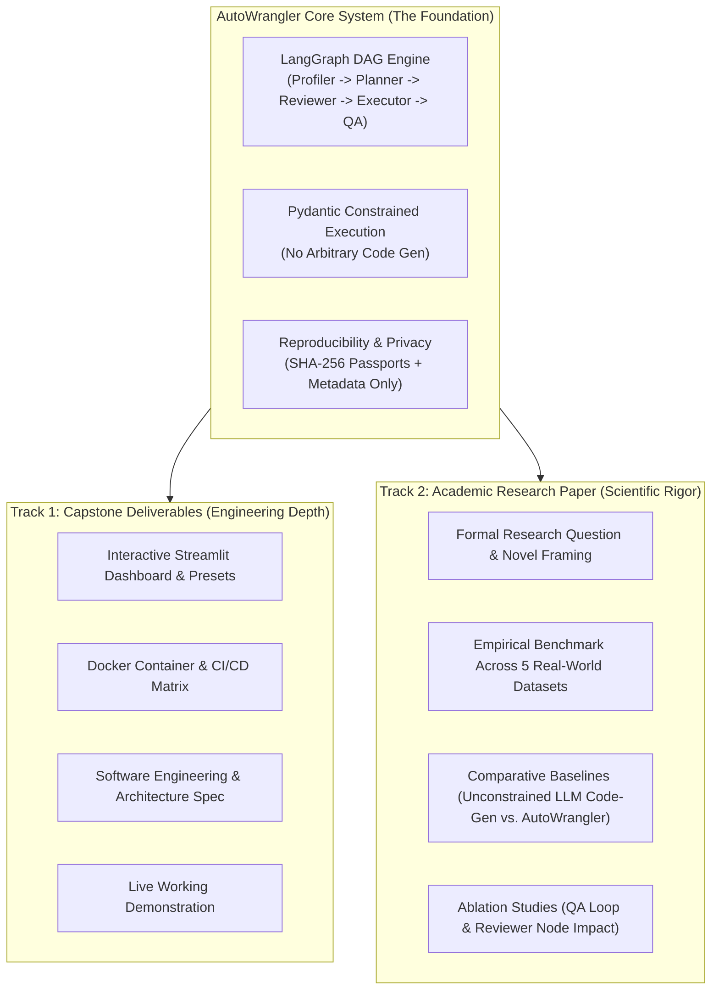

# The Dual-Track Master Plan: Transforming AutoWrangler into an Elite Capstone & Published Research Paper

To make **AutoWrangler** simultaneously succeed as a **standout Capstone Project** and a **peer-reviewed Research Paper**, you do not need two separate projects. Instead, you build a **System Track** (the software product for the capstone) and an **Empirical Research Track** (the scientific experiment and benchmark for the paper).

---

## 1. The Strategy at a Glance

---

## 2. Track 1: The Capstone Track (What Makes Evaluators Give an A+)

Capstone committees look for software engineering maturity, safety, architecture, and user experience. AutoWrangler is already 85% there. To achieve full marks:

1. **Production-Ready Artifacts**:
   - Provide the complete Docker setup with non-root security.
   - Point to the CI/CD pipeline running 25 automated tests on Python 3.12/3.13.
2. **Defensible Architectural Decisions**:
   - Defend **why** you chose LangGraph over linear scripts (enables autonomous self-correcting retry loops).
   - Defend **why** you prohibited `exec(python_code)` (eliminates prompt injection, arbitrary code execution, and dependency crashes).
   - Defend **why** you separated metadata profiling from raw data (data privacy compliance with GDPR/HIPAA).
3. **Capstone Report Deliverables**:
   - Use `CAPSTONE_ARCHITECTURAL_SPEC.md` as the foundation for the architectural chapter.
   - Include the **Reproducibility Passport** showing cryptographic SHA-256 input/output digests.

---

## 3. Track 2: The Research Paper Track (What Makes Reviewers Accept the Paper)

Academic reviewers do not accept papers that merely say *"we built a cool data cleaning tool"*. They accept papers that answer a fundamental **Research Question** with **empirical evidence**.

### Step A: The Research Framing & Title

**Working Paper Title**:
> *"Constrained Multi-Agent Orchestration vs. Unconstrained Code Generation: A Verifiable, Privacy-Preserving Framework for Tabular Data Wrangling"*

**The Research Thesis**:
> Unconstrained LLMs generating raw Python/Pandas code (`exec()`) suffer from high execution failure rates, silent data corruptions (such as stripping leading zeroes or mangling dates), and critical privacy leaks. We propose a constrained multi-agent state machine that decouples probabilistic planning over aggregate metadata from deterministic schema-bounded execution. We prove that this approach achieves superior data integrity, 0% runtime exceptions, 90%+ lower token overhead, and cryptographic verifiability.

---

### Step B: The 4 Core Research Questions (RQs)

Your paper will be structured around answering these four questions:

1. **RQ1 (Data Integrity & Quality)**:
   - Does AutoWrangler achieve higher cleaning accuracy and lower unintended data mutation rates compared to unconstrained LLMs and rule-based baselines?
2. **RQ2 (Safety & Execution Reliability)**:
   - What is the execution failure rate? (*Hypothesis*: Unconstrained code generation fails in 15–30% of dirty edge cases due to `KeyError`, `TypeError`, or hallucinated library imports, while AutoWrangler has 0% execution failures).
3. **RQ3 (Privacy & Token Efficiency)**:
   - What is the token transmission cost? (*Finding*: Sending column parse rates and counts uses 92% fewer tokens than prompting with raw sample rows, while preventing private customer data leakage).
4. **RQ4 (Ablation Analysis)**:
   - What is the marginal contribution of each agentic component?
     - *Ablation 1*: AutoWrangler without the `Plan Reviewer` node.
     - *Ablation 2*: Single-pass execution vs. closed-loop `QA Validator` retries (Pass@1 vs. Pass@2).
     - *Ablation 3*: Local deterministic heuristic planner vs. hosted LLMs (Groq / Mistral / Ollama).

---

### Step C: The Empirical Evaluation Setup

To convince academic reviewers, you will expand the benchmark beyond synthetic data:

#### 1. Test Across 5 Public Real-World Dirty Datasets
Include diverse domains from recognized data repositories (UCI ML Repository / Kaggle / OpenML):
- **E-Commerce Transactions**: Messy currency symbols, trailing whitespace, accounting parentheses.
- **Healthcare / Hospital Quality**: Heavy sentinel missing markers (`NULL`, `9999`, `N/A`), strict ID preservation.
- **Census / Adult Income**: Mixed continuous and categorical variables with special character nulls (`?`).
- **IoT Telemetry**: High-frequency sensor anomalies and extreme outliers.
- **Zoning / Real Estate**: Mixed address text, missing postal codes with leading zeroes.

#### 2. Test Against 3 Competing Baselines
- **Baseline 1 (Heuristic Auto-Cleaner)**: Standard rule-based cleaning (e.g., `CleanPy` or standard Pandas heuristics).
- **Baseline 2 (Unconstrained LLM Code Generation)**: Pass schema + data sample to GPT-4o / Claude 3.5 / Llama 3 with the prompt: *"Write a Python script to clean this CSV dataset."* Measure execution errors, runtime exceptions, and hallucinated modifications.
- **Baseline 3 (AutoWrangler)**: Your constrained DAG with Pydantic operation enforcement and QA self-correction.

#### 3. Metrics to Report in Paper Tables
- **Cleanliness / Anomaly F1 Score**: Precision, Recall, and F1 on labeled dirty values.
- **Identifier Preservation Rate**: Percentage of ID/ZIP columns where leading zeroes and exact string formats survive.
- **Execution Success Rate (%)**: Percentage of runs that complete without uncaught exceptions.
- **Prompt Token Consumption**: Total tokens transmitted per dataset.
- **Execution Latency**: Wall-clock runtime in seconds.

---

## 4. The Unified Execution Roadmap

| Milestone | Deliverables | Serves |
|---|---|:---:|
| **Milestone 1: Multi-Dataset Benchmark** | Create `reports/academic_benchmark.py` running AutoWrangler and Baselines across the 5 datasets, exporting automated LaTeX comparison tables. | **Paper & Capstone** |
| **Milestone 2: Ablation Experiments** | Run benchmark runs toggling the Reviewer node and QA retries to generate quantitative ablation curves. | **Paper** |
| **Milestone 3: Advanced Feature Polish** | Add Shannon Byte Entropy detection to `Profiler` (for data corruption and leak detection). | **Both** |
| **Milestone 4: Paper Drafting** | Write a 6–8 page paper in IEEE or ACM template summarizing architecture, RQs, and benchmark tables. | **Paper** |
| **Milestone 5: Capstone Presentation** | Prepare interactive slide deck and live Streamlit demo using the benchmark results as evidence of project superiority. | **Capstone** |

---

## 5. Recommended Target Publication Venues

1. **Workshops (High Acceptance & Fast Turnaround)**:
   - **HILDA** (Workshop on Human-in-the-Loop Data Analytics at ACM SIGMOD)
   - **DEEM** (Data Management for End-to-End Machine Learning at ACM SIGMOD / VLDB)
   - **NeurIPS / ICLR Workshops** on Foundation Models for Structured Data & Table Representation
2. **Applied Conferences**:
   - **IEEE BigData** (Industry & Government Applications Track)
   - **ACM SAC** (Symposium on Applied Computing — Data Engineering Track)
3. **Preprint / Immediate Citation**:
   - **arXiv (cs.DB / cs.AI)**: Upload the paper immediately with a link to your public GitHub repo for public citations.

