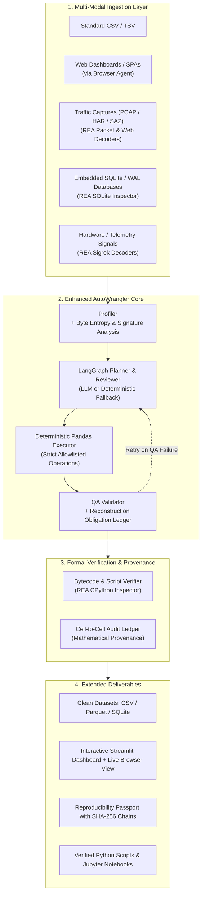

# AutoWrangler Upgrades: Integrating Reverse-Engineer-Anything (REA) & Browser Automation

## 1. Executive Summary: The Paradigm Shift

**AutoWrangler** currently operates as a constrained, deterministic tabular pipeline designed for static CSV datasets:
`CSV -> Profiler -> Planner -> Reviewer -> Executor -> QA -> Analyst -> Exports`

While robust, practical real-world data wrangling rarely starts with tidy, isolated CSV files on disk. Messy data lives inside **network captures (PCAP / HAR / SAZ)**, **application databases (SQLite / WAL)**, **dynamic Single Page Applications (SPAs)**, **telemetry/hardware signal streams**, or **embedded within binary blobs**.

By infusing **Reverse-Engineer-Anything (REA)** and **Browser Agent (`/browser`)** capabilities, AutoWrangler evolves from a simple **"CSV cleaner"** into a **Universal Reverse-Engineered Data Ingestion and Transformation Platform**.

---

## 2. Architectural Blueprint

---

## 3. Key Upgradation Vectors

### Vector A: Multi-Modal Reverse-Engineered Ingestion (via REA)

Currently, users must manually locate, parse, and export tabular data to CSV before AutoWrangler can operate. REA provides target-free and engine-driven decoders that can act as native pipeline extractors:

| Source Target | REA Primitive | AutoWrangler Ingestion Upgrade |
|---|---|---|
| **SQLite / App State** | `inspect_sqlite_database` | Directly cleans SQLite databases, inspecting raw tables, resolving schema drift, and reconstructing transactions from sibling WAL files without database locking. |
| **Network & API Traffic** | `inspect_pcap_capture`, `inspect_web_network_capture` (HAR/SAZ) | Ingests raw network traffic or HTTP archives, parsing requests/responses, payload sizes, status codes, and latency into structured tabular session logs ready for cleaning and anomaly detection. |
| **Hardware & IoT Signals** | `decode_signal_recording`, `inspect_signal_decoders` | Decodes logic analyzer/sigrok sensor traces, CAN bus streams, and serial logs into structured time-series datasets. |
| **Compiled Binaries / Metadata** | `inspect_pe_imports`, `inspect_rust_binary`, `inspect_go_binary`, `inspect_model_artifact` | Extracts software dependency inventories, PE security features, or GGUF/safetensors layer dimensions into tabular security/audit data. |

---

### Vector B: Live Web Wrangling & Dynamic SPA Harvesting (via `/browser`)

Real-world datasets are frequently locked behind web portals, internal dashboards, and paginated web tables.

1. **Autonomous Web Table Extraction**:
   - The user inputs a URL instead of a file path.
   - The `/browser` agent navigates to the page, executes client-side rendering (React/Vue/Angular), triggers pagination or infinite scrolling, and extracts the tabular data directly into the AutoWrangler staging buffer.
2. **Reverse-Engineering Obfuscated Web APIs**:
   - Web scraping based on CSS selectors is notoriously fragile.
   - Using REA's web network observation (`observe_web_session`, `inspect_web_network_capture`), AutoWrangler can intercept the underlying XHR/Fetch JSON responses directly from the browser's network layer. It extracts pure structured data before the frontend DOM even renders it.
3. **AgentEnv Reproducibility Bundles**:
   - Using REA's `export_environment_bundle`, AutoWrangler can record web interactions and network responses into a self-contained, reproducible test fixture for automated CI data testing.

---

### Vector C: Byte-Level Anomaly & Security Profiling (via REA)

AutoWrangler currently detects anomalies using numerical Z-scores on continuous columns. REA introduces deep byte-level heuristics:

1. **Shannon Entropy Profiling (`inspect_byte_entropy`)**:
   - Compute byte entropy per column or text cell.
   - High entropy signals accidentally committed API keys, encrypted ciphertext, binary corruptions, or password hashes leaking in plain CSV columns.
   - Low entropy signals repetitive padding, mock values, or truncated strings.
2. **Signature & Encoding Discovery**:
   - Automatically detect embedded encoded data (Base64 blobs, compressed zlib fragments, UUIDs, hex strings, or raw serialized objects) stored inside generic text fields and offer automated unpacking operations.

---

### Vector D: Formal Transformation Verification & Reconstruction Ledgers

AutoWrangler exports standalone Python scripts and Jupyter notebooks, claiming reproducibility. REA principles allow mathematical proof of this claim:

1. **Reconstruction Obligation Ledger (`build_reconstruction_obligation_ledger`)**:
   - Track every single data point with a cell-level obligation ledger:
     $$\text{Cell}_{(r, c)}^{\text{input}} \xrightarrow{\text{Op}_i(\theta)} \text{Cell}_{(r', c')}^{\text{output}}$$
   - Detects accidental row drops, silent floating-point precision truncation, null-filling boundary leaks, or timezone-shifting anomalies before the data leaves the pipeline.
2. **CPython Bytecode & Script Verification (`inspect_python_pyc`)**:
   - Compile the generated standalone Python export and verify that its AST and execution path match the deterministic internal executor.
   - Proves to compliance and security teams that the exported standalone script is 100% faithful to the pipeline run.

---

## 4. Prioritized Implementation Roadmap

### Phase 1: High-Impact Quick Wins (1-2 Weeks)
- [ ] **SQLite / DB Ingestion Module**: Add SQLite snapshot ingestion alongside CSV in `main.py` and `streamlit_app.py`.
- [ ] **Byte Entropy Column Profiler**: Add an entropy scanner in the `Profiler` node to detect encrypted/corrupted data.
- [ ] **Browser URL Scraper Preset**: Add a "Scrape from Web" input option in Streamlit that uses headless browser automation to extract HTML/JSON tables.

### Phase 2: Protocol & Network Wrangling (2-3 Weeks)
- [ ] **HAR / SAZ / PCAP Ingestor**: Allow users to drop web network recordings to produce tabular request/response latency and telemetry datasets.
- [ ] **Automated Network Stream Extraction**: Intercept background REST API payloads from web pages during browser navigation.

### Phase 3: Formal Verification & Audit (3-4 Weeks)
- [ ] **Reconstruction Obligation Ledger**: Introduce an immutable transformation audit ledger verifying zero unintended data mutation.
- [ ] **Export Verification Hook**: Automatically run and hash-verify exported standalone Python scripts against the pipeline output.

